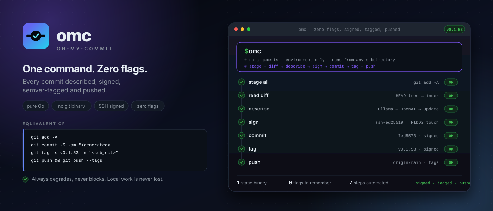
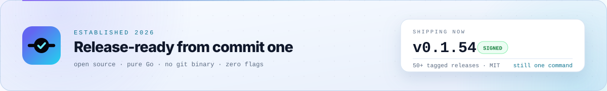
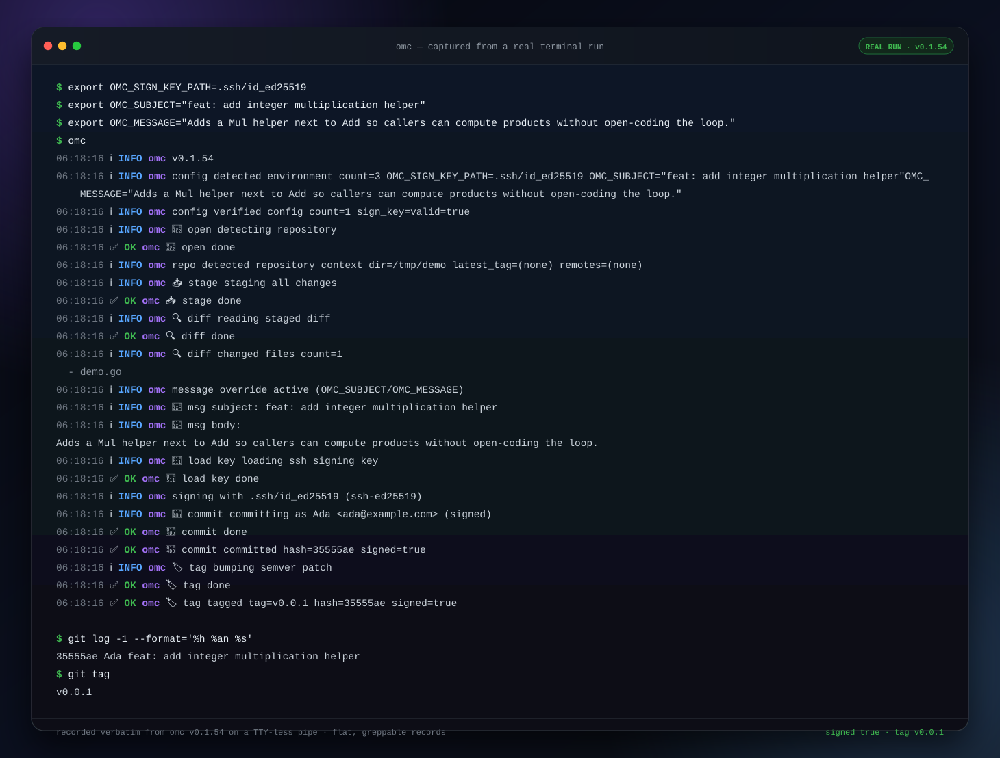
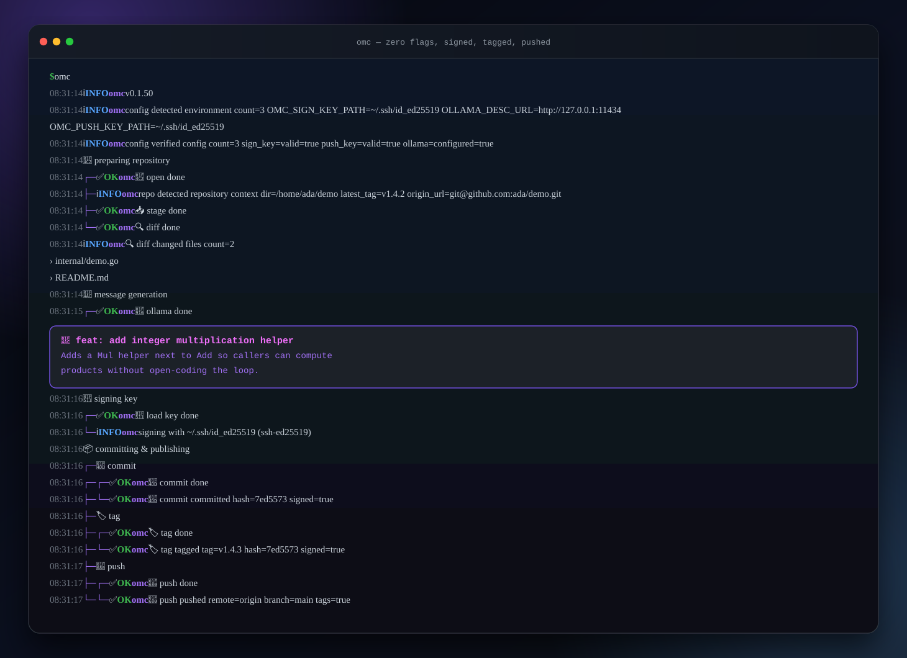
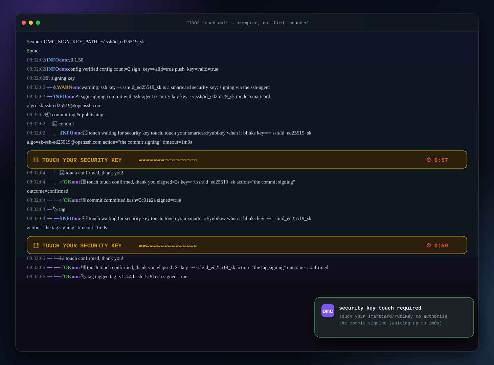
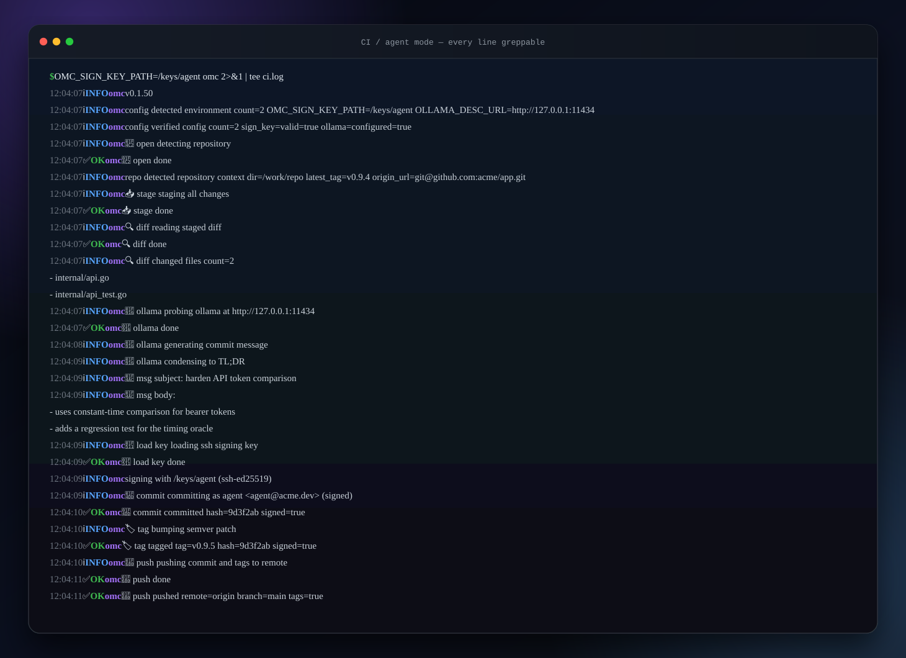
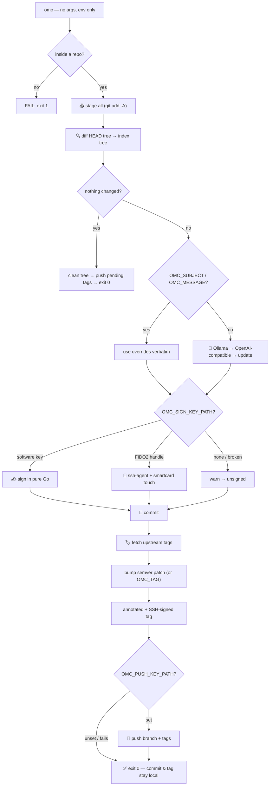

<div align="center">

<picture>
  <source media="(prefers-color-scheme: dark)" srcset="docs/hero-dark.svg">
  <source media="(prefers-color-scheme: light)" srcset="docs/hero-light.svg">
  
</picture>


# omc

### oh-my-commit

**One command. Zero flags. Every commit described, signed, semver-tagged and pushed.**

`git add -A` → AI commit message → SSH signature → semver tag → optional push.
Pure Go, one static binary, no `git` process at runtime.

[](https://go.dev)
[](#how-it-works)
[](#-quick-start)
[](#-signing)
[](LICENSE)

[Quick start](#-quick-start) · [30-second demo](#-30-second-demo) · [See it run](#-see-it-run) · [Configuration](#-configuration) · [Agent workflows](#give-an-agent-commit-rights-not-publish-rights) · [How it works](#-how-it-works)

<picture>
  <source media="(prefers-color-scheme: dark)" srcset="docs/established-dark.svg">
  <source media="(prefers-color-scheme: light)" srcset="docs/established-light.svg">
  
</picture>

</div>

The hero banner is the whole run in one frame: `$ omc` expanded into its seven
steps, each mapped to the git command it replaces. GitHub picks the variant
matching your theme; the hand-built SVG stays sharp at any width.

---

## ⚡ The entire API is three letters

```console
$ omc
```

No subcommands, no flags, no interactive prompts. Every behavior is an
environment variable, so the same binary works in your shell, in CI, and inside
an AI coding agent with no keyboard attached.

```text
$ omc
  ├─ repository discovered          git add -A
  ├─ staged diff read               edit history, not just file names
  ├─ commit message generated       local Ollama, or an OpenAI-compatible API
  ├─ commit SSH-signed              software key or FIDO2 smartcard
  ├─ upstream tags fetched          collision-proof semver bump
  └─ tag created and pushed         annotated, signed, published with the commit
```

> **Three letters.** No `git commit -am`, no `-S`, no `--tags`, no flags to
> forget. `alias commit=omc` and move on.

---

## 🚀 Quick start

```console
go install paepcke.de/omc/cmd/omc@latest
```

Then, from anywhere inside a git repository:

```console
omc
```

That is already a working commit: staged, messaged, tagged `v0.0.1`, done. Now
turn on the good parts:

```console
export OLLAMA_DESC_URL=http://127.0.0.1:11434   # local AI message
export OMC_SIGN_KEY_PATH=~/.ssh/id_ed25519      # SSH-signed commit + tag
export OMC_PUSH_KEY_PATH=~/.ssh/id_ed25519      # push after tagging
omc
```

Or run it straight from the module cache, no install step:

```console
go run paepcke.de/omc/cmd/omc@latest
```

Build from source:

```console
git clone <this repo>
cd omc
make build
sudo install -m0755 omc /usr/local/bin/
```

`make build` stamps the latest git tag into the binary with `-ldflags`. A plain
`go build ./cmd/omc` uses the hardwired version.

---

## ✨ Why this feels different

Most commit helpers wrap `git` and add flags. `omc` **is** the pipeline: it
opens the repository, stages the tree, reads the diff, asks a local model,
signs with your key, writes the objects, bumps the tag and pushes. One binary,
no shell-outs, nothing half-finished.

<table>
<tr>
<td width="50%" valign="top">

### 🔐 Commit hygiene is a security control
Signed, well-described commits are an audit trail. Every object is attributable
to a key you control, and the message explains the change in the author's own
words.

</td>
<td width="50%" valign="top">

### 🤖 Built for coding agents
An agent should be able to *commit* without being able to *publish*. Give it a
signing key with no push rights. Review the signed object. Push it yourself
with your own key.

</td>
</tr>
<tr>
<td width="50%" valign="top">

### 🪶 Ridiculously small surface
No flags, no config file, no daemon, no telemetry. One binary. Environment
variables in, structured logs out.

</td>
<td width="50%" valign="top">

### 🧯 Always degrades, never blocks
Broken key? Commit unsigned. Ollama down? Try OpenAI. OpenAI down? Use
`update`. Push failed? Commit and tag stay local and safe. No half-finished
state, ever.

</td>
</tr>
</table>

---

## 🧾 The receipt every commit leaves behind

A normal commit records *what* changed. An `omc` commit records **what, why,
who signed it, and which release it belongs to**:

```text
commit 7ed5573
Author: you <you@example.com>

    fix: harden login against timing attacks

    Uses constant-time comparison for bearer tokens.
    Generated locally, reviewed before push.

    gpgsig -----BEGIN SSH SIGNATURE-----
     U1NIU0lHAAAAAQAAADMAAAALc3NoLWVk...
     -----END SSH SIGNATURE-----

tag v0.1.55
Tagger: you <you@example.com>

    fix: harden login against timing attacks
    -----BEGIN SSH SIGNATURE-----
     U1NIU0lHAAAAAQAAADMAAAALc3NoLWVk...
     -----END SSH SIGNATURE-----
```

Verify any of it with stock git:

```console
$ git verify-commit HEAD
$ git tag -v v0.1.55
```

That is the demo. No dashboards, no service, no lock-in: your existing remote
and your existing keys already understand all of it.

---

## 🎬 See it run

A real run, start to finish: a scratch repo, one edited file, an SSH key, and
nothing else. This is the actual terminal output, wrapped only at the window
edge. Signing, the commit hash, and the tag are all genuine.



More terminal captures below. Expand to view them.

<details>
<summary><b>📸 Screenshots</b> — full pipeline, FIDO2 touch, CI mode</summary>

### The full pipeline — signed, tagged, pushed



### FIDO2 security key — prompted, notified, bounded

A real YubiKey never blocks the run. Every smartcard wait gets a structured
record, an animated countdown, a desktop notification after a few seconds, and a
hard deadline (`OMC_TOUCH_TIMEOUT`, default 60s). A missed touch degrades to an
unsigned commit instead of hanging your terminal forever.



### CI and agent mode — every line greppable

Piped logs use the same structured records without the animation:

```text
<HH:MM:SS> <LEVEL> omc [<step>] <message> [key=value ...]
```

Field values containing whitespace are quoted, so `grep 'signed=true'`,
`grep 'tag='`, and `grep 'outcome=confirmed'` always return clean tokens.



</details>

---

## 🧪 30-second demo

No remote, no config, no key required. Throwaway repo, one file, one command:

```console
$ mkdir /tmp/omc-demo && cd /tmp/omc-demo && git init -q
$ echo "hello from omc" > hello.txt
$ omc
$ git log --oneline -1 && git tag --sort=-v:refname | head -1
```

Result: a real commit with a generated message, already tagged `v0.0.1`.
Add `OMC_SIGN_KEY_PATH` and the same line produces a signature that
`git verify-commit` accepts. Add `OMC_PUSH_KEY_PATH` and the tag is already on
your remote before you think to ask.

That is the whole trick: the boring, error-prone part of shipping a change is
now the *default* behavior of one command.

---

## ⚙️ Configuration

Everything is opt-in. With no variables at all, `omc` still creates an unsigned
commit tagged `v0.0.1` with the subject `update`.

| Variable | What it does |
| --- | --- |
| `OMC_SIGN_KEY_PATH` | SSH **private** key used to sign the commit and tag. Software keys are loaded directly; FIDO2 handles (`id_ed25519_sk`, `id_ecdsa_sk`) sign through the ssh-agent and smartcard. Missing/broken → warn and commit unsigned. |
| `OLLAMA_DESC_URL` | Local Ollama base URL, e.g. `http://127.0.0.1:11434`. Enables AI commit messages. |
| `OLLAMA_DESC_MODEL` | Ollama model (default `llama3.2`). |
| `OPENAPI_URL` | OpenAI-compatible base URL, e.g. `http://localhost:8080/v1`. Fallback when Ollama is not configured, unreachable, or fails mid-generation. |
| `OPENAPI_MODEL` | Model for the OpenAI-compatible endpoint (default `gpt-3.5-turbo`). |
| `OPENAPI_TOKEN` | Bearer token for that endpoint. Never printed; logs show `(set)` only. |
| `OMC_NAME` / `OMC_EMAIL` | Commit identity. Falls back to `GIT_AUTHOR_*` / `GIT_COMMITTER_*`, then repo config, then `OMC, Git Commiter <git@omc.local>`. |
| `OMC_SUBJECT` | Exact commit subject. Skips AI generation. |
| `OMC_MESSAGE` | Exact commit body. Skips AI generation. |
| `OMC_TAG` | Explicit tag name. Used only when it is strict `vMAJOR.MINOR.PATCH`; otherwise auto-bump runs with a warning. |
| `OMC_PUSH_KEY_PATH` | SSH key (or FIDO2 handle) used to push the branch and tags after committing. Also authenticates the pre-tag upstream tag fetch. |
| `OMC_TOUCH_TIMEOUT` | Seconds to wait for a smartcard touch (default `60`; `0` waits forever, matching OpenSSH). |
| `OMC_TOUCH_NOTIFY` | `auto` (detect a freedesktop notification daemon), `on`, or `off`. Detection only runs when a security-key path is configured. |

`OPENAPI_DESC_URL`, `OPENAPI_DESC_MODEL`, and `OPENAPI_DESC_TOKEN` are accepted
as legacy aliases for the OpenAI-compatible settings.

> [!WARNING]
> **Keys must be passphrase-less.** There is no interactive prompt by design:
> `ssh-keygen -t ed25519 -N "" -f ~/.ssh/agent`. Protect the key with file
> permissions and rotate it like any credential. Smartcard keys must be loaded
> in a running ssh-agent (`ssh-add ~/.ssh/id_ed25519_sk`); the device enforces
> the touch/PIN check itself.

---

## 🧠 AI commit messages

When Ollama (or the OpenAI-compatible fallback) is reachable, the staged diff is
sent in two passes:

1. **Detail** — "explain what changed and why", using the per-file diff and the
   changed-file list.
2. **TL;DR** — condense that detail into an imperative subject (≤72 chars).

The result is:

```text
<TL;DR subject>

<detailed body>
```

Fallback order is deliberate and observable:

```text
Ollama → OpenAI-compatible endpoint → update
```

A backend that probes fine but fails while generating is abandoned for the next
one. If the detail pass succeeds but only the TL;DR pass fails, the detail is
salvaged: its first line becomes the subject instead of throwing the whole
generation away.

Large diffs are truncated per file section (200 lines triggers a 100-line cut,
keeping the header and both ends), so one generated file cannot eat the model's
context window.

Lockfiles are never sent: `flake.lock` is machine-generated pin-hash noise —
pointless context for a model and no help for a commit message. A changed
lockfile appears in the diff as a single stub line (`flake.lock updated`,
content suppressed) and in the changed-file list, and nothing more.

<details>
<summary><b>🔒 Local-first by default</b></summary>

Ollama runs on localhost; your code and diffs never leave the machine. An
OpenAI-compatible endpoint is only contacted when you configure one. `omc` has
no telemetry and phones no home.

</details>

---

## ✏️ Overrides

Sometimes you already know the message. Any override skips AI generation.

```console
OMC_SUBJECT="fix: harden login against timing attacks" \
OMC_MESSAGE="Uses constant-time comparison for bearer tokens." \
OMC_TAG="v1.4.0" \
omc
```

| `OMC_SUBJECT` | `OMC_MESSAGE` | Subject | Body |
| --- | --- | --- | --- |
| set | set | `OMC_SUBJECT` | `OMC_MESSAGE` |
| set | unset | `OMC_SUBJECT` | `OMC_SUBJECT` |
| unset | set | first non-empty line (≤72 chars) | full `OMC_MESSAGE` |
| unset | unset | AI TL;DR or `update` | AI detail |

`OMC_TAG` is used verbatim only if it is strict semver: optional leading `v`,
three numeric segments, no leading zeros, no pre-release/build suffix. A bare
`1.2.3` becomes `v1.2.3`. Anything else warns and falls back to the auto-bump.

---

## 🏷️ Zero-collision semver tags

After every commit, `omc` tags the new object:

1. **Fetch upstream tags first** (`git fetch --tags`, in-process go-git) so a
   tag pushed from another machine is visible before the name is generated.
2. Read the highest valid `vX.Y.Z` tag. Pre-release suffixes like `-rc.1` use
   their base version; malformed tags (`v1.2.3.4`, `v1.2.3junk`) are ignored.
3. Bump the patch: `v1.4.2 → v1.4.3`. No tag yet means `v0.0.1`.
4. Create an **annotated** tag whose message is the commit subject.
5. SSH-sign the tag with the same key as the commit, exactly like `git tag -s`.

The fetch is best-effort and uses the remote's fetch URL. A repository with no
remote still works; a failed fetch only warns and bumps from local state. If
the tag step fails, the commit is never rolled back.

---

## 🚀 Push

Set `OMC_PUSH_KEY_PATH` and `omc` pushes the current branch and all local tags
after tagging, the equivalent of `git push && git push --tags`:

```console
$ omc
...
✅ OK omc 🏷️ tag tagged tag=v1.4.3 hash=7ed5573 signed=true
✅ OK omc 🚀 push pushed remote=origin branch=main tags=true
```

- The branch is pushed first, then `+refs/tags/*` (forced, like `git push --tags`).
- An already-up-to-date branch does **not** skip the tag pass: pending local tags
  from a previously failed push still get published.
- A clean working tree still runs the push, so those pending tags are not
  stranded.
- Any push failure warns and exits 0. The commit and tag stay local; nothing is
  rolled back.
- FIDO2 push keys authenticate through the ssh-agent. That SSH signature is a
  touch wait too, with the same prompt, notification, and timeout.

---

## 🔑 Signing

`OMC_SIGN_KEY_PATH` enables SSH signing in git's own format. The commit object
carries a `gpgsig` header with an armored `BEGIN SSH SIGNATURE` block; the tag
carries the same signature over its canonical payload.

```console
$ git log --show-signature -1
$ git verify-commit HEAD
$ git tag -v v1.4.3
```

### Software keys

Loaded directly in pure Go. No `ssh-keygen`, no `gpg`, no helper process.

### FIDO2 security keys

`id_ed25519_sk` / `id_ecdsa_sk` handles are detected by name and by their `.pub`
file, then signed through the ssh-agent. The private half never leaves the
device; the authenticator enforces presence (and PIN).

A touch wait produces:

- a structured `touch` record **before** the blocking signature;
- an animated `🔑 TOUCH YOUR SECURITY KEY` countdown and a terminal bell on a TTY;
- a desktop notification after a few seconds via the freedesktop D-Bus
  interface (GNOME, KDE, XFCE, …), no `notify-send` binary;
- a WARN record and a degrade path on timeout.

The same policy covers every smartcard operation: commit signing, tag signing,
the upstream tag fetch, and the push.

---

## 🛡️ Give an agent commit rights, not publish rights

Your agent can write code. It should leave a **receipt**, not a force-push.
Give it a signing key with no push rights: it can author and sign, you review
the object and publish with your own key.

```console
# What the agent gets: sign only.
export OMC_SIGN_KEY_PATH=~/.ssh/keys/agent-commit
export OLLAMA_DESC_URL=http://127.0.0.1:11434
omc
```

```console
# What you keep: the push credential.
git log --show-signature -1     # review the signed object
git push                        # publish with your own key
```

| Activity | Credential | Holder |
| --- | --- | --- |
| Author and sign a commit locally | `agent-commit` signing key | the agent |
| Publish to the remote | your SSH key / deploy key | **you** |

If you *want* the agent to publish, give it a dedicated low-privilege push key
via `OMC_PUSH_KEY_PATH`. The push happens only after the commit and tag exist,
and a failed push never loses local work.

More patterns:

- **Agentic refactors** — a stack of small, signed, described commits; review
  the set before one push.
- **CI / cron** — dependency bumps commit with a dedicated signing key; humans
  still control the merge.
- **Audit trail** — the model's change explanation becomes the commit body,
  stored forever next to the signature.

---

## 🧭 How it works



### Everything degrades

| What went wrong | What omc does |
| --- | --- |
| Not inside a git repository | Fails with a clear error, exit 1 |
| Signing key missing, corrupt, passphrase-protected | Warns, commits unsigned |
| Security-key handle not loaded in ssh-agent | Warns, commits unsigned |
| Smartcard touch not received in time | Warns, commits unsigned; tag/pull/push degrade |
| Ollama unreachable | Probes the OpenAI-compatible endpoint |
| Ollama reachable but generation fails | Falls back to the OpenAI-compatible endpoint |
| Both AI backends unavailable or failing | Uses the subject `update` |
| No remote for the tag fetch | Bumps from local tag state |
| Tag already exists | Warns and exits 0; the commit is untouched |
| Push fails | Warns, exits 0; commit and tag remain local |

### Pure Go, no runtime sidecars

No subprocess, no `git` binary, no `ssh-keygen`, no `notify-send`. Repository
discovery, staging, diffs, commits, annotated tags, fetch, push, SSH
signing, D-Bus notifications — all libraries. The only external things `omc`
talks to are the services you configure: your Ollama/OpenAI endpoint and your
git remote.

---

## 🛠️ Development

```console
make build      # go build -o omc ./cmd/omc (stamps the git tag)
make test       # go test ./...
make vet        # go vet ./...
gofmt -s -w .   # formatting gate
```

The module requires the Go version in `go.mod`. Tests create real git repos in
temporary directories; push/pull tests use an in-process git server, so no
network or binaries are needed. `-short` skips the binary e2e suite.

Contributions are welcome: small, well-tested, minimal diffs. Every commit is
release-ready by default because the repo tags its own commits.

<details>
<summary><b>🧪 Test coverage notes</b></summary>

- `go test ./...` covers config, signing, Ollama, OpenAI, gitops, output, and
  the compiled binary end to end.
- `CGO_ENABLED=1 go test -race ./...` exercises the spinner, touch prompt, and
  signing wrappers under the race detector.
- Signed commits and tags are verified with the real `git verify-commit` /
  `git tag -v` in the e2e tests.
- `writeIndexTree` builds git-byte-identical trees from the index so signature
  verification never hiccups.

</details>

<details>
<summary><b>🗂️ Where things live</b></summary>

```text
cmd/omc/               pipeline: repo → stage → diff → message → sign → commit → tag → push
internal/config/       env-only configuration
internal/gitops/       open, stage, diff, commit, signed commit, tags, fetch, push
internal/sign/         SSH signing, FIDO2 detection, touch-bounded agent signing
internal/touch/        shared touch event vocabulary
internal/notify/       freedesktop notifications over D-Bus
internal/llm/          shared prompts + Generator contract
internal/ollama/       local Ollama backend
internal/openai/       OpenAI-compatible fallback backend
internal/output/       structured records, spinner, log groups, touch prompt
internal/version/      hardwired semver, overridable with -ldflags
docs/hero-*.svg        theme-aware README hero banner (light/dark)
docs/established-*.svg theme-aware "established" banner (light/dark)
docs/branding/         icon, mark and the brand sheet (palette, geometry, rules)
docs/screenshots/      the terminal captures shown above
```

</details>

---

## 📄 License

MIT. See [LICENSE](LICENSE).

<div align="center">

<sub>Built with <a href="https://github.com/go-git/go-git">go-git</a> · <a href="https://github.com/charmbracelet/lipgloss">lipgloss</a> · <a href="https://github.com/hiddeco/sshsig">sshsig</a> · <a href="https://ollama.com">Ollama</a></sub>

</div>
