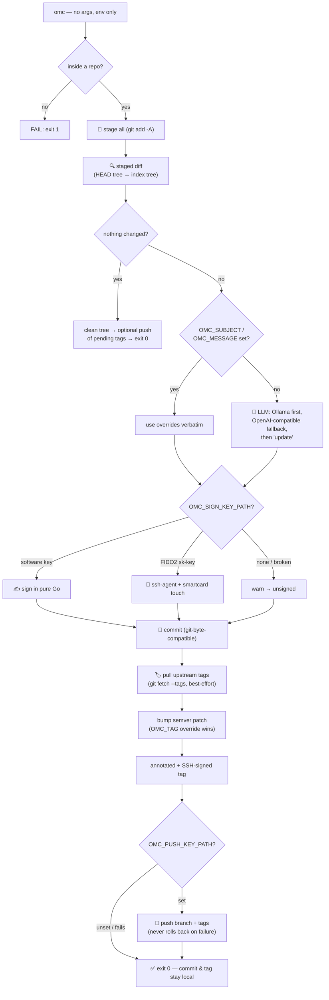

<div align="center">

# omc

**oh-my-commit — three letters, zero flags, fully signed autopilot for your git repos.**

`omc` (spoken: *"oh-my-commit"*) is a plain, stupid-simple git auto-commit,
sign, tag, and push utility written in pure Go. It takes **zero command line
arguments** and has **zero runtime dependencies** — not even `git` needs to be
installed. Every behavior is an environment variable. Inside any git working
tree, one 3-letter command does the equivalent of:

```sh
git add -A
git commit -S -m <generated detailed commit message>
git fetch --tags   # collision guard: never bump into an upstream tag
git tag -s <old_semver+1>
[opt] git push
[opt] git push --tags
```

[](https://go.dev)
[](#)
[](#)
[](LICENSE)
[](#-environment-only-design)
[](#-secure-agentic-workflows)

[Features](#-features) · [Quick Start](#-quick-start) · [Demo](#-demo) · [Pipeline](#-how-it-works) · [Why](#-why-another-commit-tool) · [Agentic Workflows](#-secure-agentic-workflows) · [Usage](#-usage)

</div>

---

## ✨ Features

<table>
<tr>
<td width="50%" valign="top">

### 🚫 Zero arguments, zero TTY
Every option is an environment variable, so it composes in scripts, aliases, pre-commit hooks, and — critically — inside an **unattended agent** that has no keyboard and must not be asked for one.

</td>
<td width="50%" valign="top">

### 🟢 Native git in Go
Repository discovery, `git add -A`, unified diffs, commits, annotated tags, fetch, and push all run through [go-git]. No external `git` process at runtime — one static binary, `make build` stamps the tag right into it.

</td>
</tr>
<tr>
<td width="50%" valign="top">

### 🔑 SSH-signed commits
Point `OMC_SIGN_KEY_PATH` at an SSH private key and the commit carries an armored `BEGIN SSH SIGNATURE` header, byte-compatible with `git commit -S`. `git log --show-signature` and `git verify-commit` confirm it.

**Smartcard (FIDO2) keys** — `id_ed25519_sk` / `id_ecdsa_sk` from `ssh-keygen -t ed25519-sk` — are supported too: omc signs through your **ssh-agent** (the agent talks to the device, which enforces the touch/PIN). On a TTY an animated `🔑 TOUCH YOUR SECURITY KEY` countdown runs while the signature waits for the device touch. No agent loaded with the key → omc warns and commits unsigned; it never blocks.

</td>
<td width="50%" valign="top">

### 🤖 AI commit messages, local-first
With `OLLAMA_DESC_URL` set, the staged diff is sent to your **local** model twice: once for a rich explanatory body, once to condense it into a one-line, imperative TL;DR. Your code never leaves your machine. When Ollama is not configured or unreachable, an **OpenAI-compatible** endpoint (`OPENAPI_URL` / `OPENAPI_TOKEN`; `OPENAPI_DESC_*` legacy aliases accepted) is used as a fallback with the same prompts.

</td>
</tr>
<tr>
<td width="50%" valign="top">

### 🏷️ Auto semver tagging — collision-proof
Every successful commit is immediately tagged with the next patch version (`vX.Y.N+1`). Before a name is generated, omc **pulls the upstream tag state** (the go-git equivalent of `git fetch --tags`): tags pushed from another machine in the meantime become visible locally, so the bump can never collide with — or force-push over — an upstream tag. The tag is annotated and SSH-signed with the same key as the commit. Set `OMC_TAG` to name the tag yourself.

</td>
<td width="50%" valign="top">

### ✏️ Message & tag overrides
Set `OMC_SUBJECT` / `OMC_MESSAGE` to bypass the LLM and write the commit text yourself, and `OMC_TAG` to name the tag. Perfect for pipelines that already know what the change is. Subject-only → subject doubles as the body; message-only → first line becomes the subject.

</td>
</tr>
<tr>
<td width="50%" valign="top">

### 👤 Flexible identity
`OMC_NAME`/`OMC_EMAIL` win, then the standard `GIT_AUTHOR_*`/`GIT_COMMITTER_*` variables, then the repo's git config, then a built-in default.

</td>
<td width="50%" valign="top">

### 🛡️ Always degrades, never blocks
No repo → clear error. No Ollama → try the OpenAI-compatible fallback → `update`. No key → unsigned. No network for the tag pull → warn and bump from local state. Failed push → commit and tag stay local, never rolled back. Untouched yubikey → after `OMC_TOUCH_TIMEOUT` the commit falls back to unsigned. It never leaves a task half-done over infrastructure.

</td>
</tr>
<tr>
<td width="50%" valign="top">

### 🚀 Optional push
Set `OMC_PUSH_KEY_PATH` to an SSH key and `omc` pushes the new commit and its tag to the default remote after tagging — `git push; git push --tags`, all in-process via go-git. When the working tree is clean, the push still runs so tags left behind by a previously failed push get published. The push key also accepts a **FIDO2 security-key handle**: auth goes through the ssh-agent and your smartcard, with the same touch prompt, desktop notification, and timeout as every other smartcard wait.

</td>
<td width="50%" valign="top">

### 🔁 Idempotent & predictable
No flags to remember, no prompts to answer, no tags that collide. Configure once (env-only), then 3-letter autopilot everywhere.

</td>
</tr>
</table>

> [!TIP]
> Alias it once and forget it exists: `alias commit='omc'`. From now on every
> save in any repo is a signed, described, semver-tagged commit.

---

## 🚀 Quick Start

> Run from **anywhere inside a repo**. That's it.

```console
go run paepcke.de/omc/cmd/omc@latest
```

### Install

```console
go install paepcke.de/omc/cmd/omc@latest
```

Or build from source:

```console
git clone <this repo>
cd omc
make build
sudo install -m0755 omc /usr/local/bin/
```

### Run

```console
export OLLAMA_DESC_URL=http://127.0.0.1:11434   # optional: AI messages
export OMC_SIGN_KEY_PATH=~/.ssh/id_ed25519      # optional: SSH signing
omc
```

A one-shot signed commit with an explicit subject and tag:

```console
OMC_SIGN_KEY_PATH=~/.ssh/id_ed25519 \
OMC_SUBJECT="fix: harden login against timing attacks" \
OMC_TAG="v1.4.0" \
omc
```

> [!NOTE]
> Optional extras: a running [Ollama] server for AI-generated commit
> messages, an SSH private key to sign commits, and an SSH key for pushing.
> Without any of them omc still works — it just commits unsigned, with the
> `update` subject, and skips the push.

---

## 🎬 Demo

When stderr is a terminal, `omc` renders a structured, timestamped TUI
built on [lipgloss]: every line is a structured log record of the form
`<HH:MM:SS> <LEVEL> omc [<step>] <message> [key=value ...]`, with
animated spinners per pipeline step, color-coded levels (OK / INFO / WARN
/ FAIL), and an animated touch countdown when a FIDO2 security key is
used. Related steps are gathered into nested log groups — `📂 preparing
repository`, `💬 message generation`, `🔑 signing key`, and `📦
committing & publishing` (the latter with `📝 commit` / `🏷️ tag` / `🚀
push` sub-groups) — each group header is itself a timestamped line, and
each record is prefixed with a tree connector (`┌─` first, `├─` middle,
`└─` last, one per open level, like `git log --graph`) so the whole run
reads as one tree.

The blocks below are real captured output (no Ollama running, so the
message falls back to `update`). Diagnostics and progress go to stderr;
the final commit and tag results go to stdout.

### 1. Software signing key

```console
$ export OMC_SIGN_KEY_PATH=~/.ssh/id_ed25519
$ echo 'func main() { fmt.Println("hi") }' >> main.go
$ omc
14:18:31 ℹ️ INFO omc omc v0.1.43
14:18:31 ℹ️ INFO omc config detected environment count=1 OMC_SIGN_KEY_PATH=~/.ssh/id_ed25519
14:18:31 ℹ️ INFO omc config verified config count=1 sign_key=valid=true
14:18:31   📂 preparing repository
14:18:31 ┌─ ✅ OK omc 📂 open done
14:18:31 ├─ ℹ️ INFO omc repo detected repository context dir=/home/ada/demo latest_tag=(none) origin_url=git@github.com:ada/demo.git
14:18:31 ├─ ✅ OK omc 📥 stage done
14:18:31 └─ ✅ OK omc 🔍 diff done
14:18:31 ℹ️ INFO omc 🔍 diff changed files count=2
  › .gitignore
  › main.go
  └ commit message
╭──────────────────────────────────────────────────────────────────────────────╮
│ 💬 update                                                                    │
╰──────────────────────────────────────────────────────────────────────────────╯
14:18:31   🔑 signing key
14:18:31 ┌─ ✅ OK omc 🔑 load key done
14:18:31 ├─ ℹ️ INFO omc signing with ~/.ssh/id_ed25519 (ssh-ed25519)
14:18:31   📦 committing & publishing
14:18:31 ┌─   📝 commit
14:18:31 ┌─ ┌─ ℹ️ INFO omc ✍️ sign signing commit with ssh key key=~/.ssh/id_ed25519
14:18:31 ├─ ├─ ℹ️ INFO omc 📝 commit committing as Ada Lovelace <ada@example.com> (signed)
14:18:31 ├─ └─ ✅ OK omc 📝 commit committed hash=3f8bc54 signed=true
14:18:31 ├─   🏷️ tag
14:18:31 ├─ ┌─ ✅ OK omc 🏷️ tag done
14:18:31 └─ └─ ✅ OK omc 🏷️ tag tagged tag=v0.0.1 hash=3f8bc54 signed=true
```

### 2. Smartcard (FIDO2) signing key — prompted, notified, bounded

With `OMC_SIGN_KEY_PATH` pointing at an `id_ed25519_sk` handle, omc signs
through the ssh-agent. Every signature that blocks on the smartcard — the
commit signing, the tag signing, the upstream tag pull, the push — is a
*touch wait*, and every touch wait gets the full treatment:

- a structured record announces the wait before the signature blocks, so a
  pending touch is always greppable in captured logs;
- on a TTY an animated countdown replaces the spinner and a terminal bell
  rings;
- after a few seconds without a touch, a desktop notification pops up
  ("omc: security key touch required") through the freedesktop
  `org.freedesktop.Notifications` D-Bus interface — GNOME, KDE, XFCE, … —
  detected at runtime (only probed when a security-key path is configured),
  pure Go, no `notify-send` binary. `OMC_TOUCH_NOTIFY=off` disables it;
- the wait is **bounded** by `OMC_TOUCH_TIMEOUT` (default 60s, `0` = forever,
  like OpenSSH): on timeout omc degrades exactly like for any unusable key —
  warn, commit unsigned, skip signing the tag — instead of hanging forever.

```console
$ ssh-add ~/.ssh/id_ed25519_sk
$ export OMC_SIGN_KEY_PATH=~/.ssh/id_ed25519_sk
$ omc
...
14:22:09   🔑 signing key
14:22:09 ┌─ ⚠️ WARN omc warning: ssh key ~/.ssh/id_ed25519_sk is a smartcard security key; signing via the ssh-agent
14:22:09 └─ ℹ️ INFO omc ✍️ sign signing commit with ssh-agent security key key=~/.ssh/id_ed25519_sk mode=smartcard algo=sk-ssh-ed25519@openssh.com
14:22:09   📦 committing & publishing
14:22:09 ┌─   📝 commit
14:22:09 ├─ ┌─ ℹ️ INFO omc 🔐 touch waiting for security key touch, touch your smartcard/yubikey when it blinks key=~/.ssh/id_ed25519_sk algo=sk-ssh-ed25519@openssh.com action=the commit signing timeout=1m0s
🔑 TOUCH YOUR SECURITY KEY  ▰▰▱▱▱▱▱▱▱▱▱▱▱▱▱▱  ⏱ 0:58
14:22:11 ├─ └─ 💛 touch confirmed, thank you!
14:22:11 ├─ ┌─ ✅ OK omc 🔐 touch touch confirmed, thank you elapsed=2s key=~/.ssh/id_ed25519_sk algo=sk-ssh-ed25519@openssh.com action=the commit signing outcome=confirmed
14:22:11 ├─ └─ ✅ OK omc 📝 commit committed hash=5c91e2a signed=true
14:22:11 ├─   🏷️ tag
14:22:11 ├─ ┌─ ℹ️ INFO omc 🔐 touch waiting for security key touch, touch your smartcard/yubikey when it blinks key=~/.ssh/id_ed25519_sk algo=sk-ssh-ed25519@openssh.com action=the tag signing timeout=1m0s
🔑 TOUCH YOUR SECURITY KEY  ▰▱▱▱▱▱▱▱▱▱▱▱▱▱▱▱▱  ⏱ 0:59
14:22:13 ├─ └─ 💛 touch confirmed, thank you!
14:22:13 ├─ ┌─ ✅ OK omc 🔐 touch touch confirmed, thank you elapsed=2s key=~/.ssh/id_ed25519_sk algo=sk-ssh-ed25519@openssh.com action=the tag signing outcome=confirmed
14:22:13 └─ └─ ✅ OK omc 🏷️ tag tagged tag=v0.0.2 hash=5c91e2a signed=true
```

No touch within the budget? Degrade, never block:

```console
14:24:02 ├─ ┌─ ℹ️ INFO omc 🔐 touch waiting for security key touch, touch your smartcard/yubikey when it blinks key=~/.ssh/id_ed25519_sk action=the commit signing timeout=1m0s
🔑 TOUCH YOUR SECURITY KEY  ▰▰▰▰▰▰▰▰▰▰▰▰▰▰▰▰  ⏱ 0:00
14:25:02 ├─ └─ ⏰ touch timed out, waiting for security key
14:25:02 ├─ ├─ ⚠️ WARN omc 🔐 touch touch timed out waiting for security key elapsed=1m0s key=~/.ssh/id_ed25519_sk action=the commit signing outcome=timeout timeout=1m0s
14:25:02 ├─ ┌─ ⚠️ WARN omc warning: commit signing timed out waiting for the security key touch; committing unsigned
14:25:02 ├─ └─ ✅ OK omc 📝 commit committed hash=3d99a1b signed=false
```

When the agent has no matching identity, omc degrades the same way:

```console
14:23:55 ⚠️ WARN omc warning: ssh key ~/.ssh/id_ed25519_sk is a smartcard security key, but no ssh-agent identity matches
(connect to ssh-agent for security key ~/.ssh/id_ed25519_sk (is ssh-agent running?): dial unix: missing address); committing unsigned
14:23:55 ✅ OK omc ✍️ sign committing unsigned signed=false
```

### 3. Subject / message / tag override

Skip the LLM entirely and write the commit text + tag name yourself:

```console
$ OMC_SUBJECT="feat: add greeting to main" \
  OMC_MESSAGE='Adds a fmt.Println("hi") entrypoint so the binary does something on run.' \
  OMC_TAG="v1.0.0" \
  OMC_SIGN_KEY_PATH=~/.ssh/id_ed25519 \
  omc
...
14:24:10 ℹ️ INFO omc config detected environment count=4 OMC_SIGN_KEY_PATH=~/.ssh/id_ed25519 OMC_SUBJECT=feat: add greeting to main OMC_MESSAGE=Adds a fmt.Println("hi") entrypoint so the binary does something on run. OMC_TAG=v1.0.0
14:24:10 ℹ️ INFO omc config verified config count=2 sign_key=valid=true tag_override=valid=true
...
14:24:10 ℹ️ INFO omc message override active (OMC_SUBJECT/OMC_MESSAGE)
14:24:10 ℹ️ INFO omc ✍️ sign signing commit with ssh key key=~/.ssh/id_ed25519
14:24:10 ℹ️ INFO omc 📝 commit committing as Ada Lovelace <ada@example.com> (signed)
14:24:11 ✅ OK omc 📝 commit committed hash=3691ad8 signed=true
14:24:11 ℹ️ INFO omc 🏷️ tag tagging v1.0.0
14:24:11 ✅ OK omc 🏷️ tag tagged tag=v1.0.0 hash=3691ad8 signed=true

$ git show --stat --oneline HEAD
3691ad8 feat: add greeting to main
 main.go | 4 ++++
 1 file changed, 4 insertions(+)
```

### 4. Optional push

With `OMC_PUSH_KEY_PATH` set, the new commit and tag are pushed to the
default remote after tagging. A security-key push path shows the same touch
countdown during SSH authentication:

```console
$ export OMC_PUSH_KEY_PATH=~/.ssh/id_ed25519
$ omc
...
14:25:02 ✅ OK omc 🏷️ tag tagged tag=v1.0.1 hash=3691ad8 signed=true
14:25:02   🚀 push
14:25:02 ┌─ ℹ️ INFO omc 🚀 push pushing commit and tags to remote
14:25:03 └─ ✅ OK omc 🚀 push pushed remote=origin branch=main tags=true
```

Piped or non-interactive output (CI logs, captured tests) automatically falls
back to the same structured, greppable line format:

```console
$ omc 2>&1 | cat
12:04:07 ℹ️ INFO omc omc v0.1.43
12:04:07 ℹ️ INFO omc config detected environment count=2 OMC_SIGN_KEY_PATH=~/.ssh/id_ed25519 OLLAMA_DESC_URL=http://127.0.0.1:11434
12:04:07 ℹ️ INFO omc config verified config count=2 sign_key=valid=true ollama=configured=true
12:04:07 ℹ️ INFO omc 📂 open detecting repository
12:04:07 ✅ OK omc 📂 open done
12:04:07 ℹ️ INFO omc repo detected repository context dir=/home/ada/demo latest_tag=v0.3.8 origin_url=git@github.com:ada/demo.git
12:04:07 ℹ️ INFO omc 📥 stage staging all changes
12:04:07 ✅ OK omc 📥 stage done
12:04:07 ℹ️ INFO omc 🔍 diff reading staged diff
12:04:07 ✅ OK omc 🔍 diff done
12:04:07 ℹ️ INFO omc 🔍 diff changed files count=2
  - internal/ollama/ollama.go
  - cmd/omc/main.go
12:04:07 ℹ️ INFO omc 🤖 ollama probing local ollama at http://127.0.0.1:11434
12:04:07 ✅ OK omc 🤖 ollama done
12:04:08 ℹ️ INFO omc 🤖 ollama generating commit message
12:04:09 ℹ️ INFO omc 🤖 ollama condensing to TL;DR
12:04:09 ℹ️ INFO omc 💬 msg subject: sign commit payloads with git's SSH signature format
12:04:09 ℹ️ INFO omc 💬 msg body:
 - Adds an armored BEGIN SSH SIGNATURE header to the commit object...
12:04:09 ℹ️ INFO omc 🔑 load key loading ssh signing key
12:04:09 ✅ OK omc 🔑 load key done
12:04:09 ℹ️ INFO omc signing with ~/.ssh/id_ed25519 (ssh-ed25519)
12:04:09 ℹ️ INFO omc ✍️ sign signing commit with ssh key key=~/.ssh/id_ed25519
12:04:09 ℹ️ INFO omc 📝 commit committing as Ada Lovelace <ada@example.com> (signed)
12:04:10 ✅ OK omc 📝 commit committed hash=9d3f2ab signed=true
12:04:10 ℹ️ INFO omc 🏷️ tag bumping semver patch
12:04:10 ✅ OK omc 🏷️ tag tagged tag=v0.3.9 hash=9d3f2ab signed=true
```

Every field is a separate, greppable token — `tag=v0.3.9`, `hash=9d3f2ab`,
`signed=true` — so downstream pipelines and log aggregators can parse them
without ambiguous whitespace. The commit and tag results go to stdout; all
diagnostics and progress go to stderr. When a FIDO2 security key is used on a
non-TTY, the animated countdown is suppressed and only the structured `touch`
notice and `touch confirmed` records are emitted, so CI logs stay greppable.

No arguments were typed. No `git` binary was spawned. No prompts were answered.
Everything that matters came from the environment.

---

## 🤔 Why another commit tool?

Commit hygiene is a **security control**, not a style preference. Signed,
meaningful commits are how you:

- **Hold agents accountable** — every change is attributable to a key you control.
- **Keep history readable** — "fix typo in login" becomes `fix: harden the login
  flow against timing attacks`.
- **Guard the supply chain** — a break in the signing chain is a break in the
  trust your `main` depends on.

The problem: your AI coding agent happily runs `git commit`, but you don't want
it holding the same keys you use to **push** to the remote. `omc` solves
exactly that — details under [Secure agentic workflows](#-secure-agentic-workflows).

---

## 🧭 Table of Contents

- [Features](#-features)
- [Quick Start](#-quick-start)
- [Demo](#-demo)
- [Why another commit tool?](#-why-another-commit-tool)
- [Secure agentic workflows](#-secure-agentic-workflows)
- [Usage](#-usage)
- [How it works](#-how-it-works)
- [Environment-only design](#-environment-only-design)
- [Development](#-development)
- [License](#-license)

---

## 🛡️ Secure agentic workflows

This is the scenario `omc` was built for. You're running an AI coding agent
— Cursor, Claude Code, Crush, a CI bot — and you want it to *commit* without
giving it the power to *publish*.

`omc` makes **separation of duties** trivial.

### 1. Separate signing keys from push keys (rights separation)

Your agent's shell gets only a **signing** key:

```console
export OMC_SIGN_KEY_PATH=~/.ssh/keys/agent-commit   # can SIGN commits, cannot push
export OLLAMA_DESC_URL=http://127.0.0.1:11434       # lets it describe its own work
omc
```

The **push** to the remote uses a *different* credential — your human
`~/.ssh/id_ed25519`, a deploy key, or a short-lived CI token — that the agent
never sees.

|| Activity | Credential | Holder |
|| -------- | ---------- | ------ |
|| Author + sign a commit locally | `agent-commit` signing key | the agent |
|| Push to the remote | your personal SSH key / deploy key | **you** |

Even if the agent is compromised, its key can authenticate against `main` all
it wants — it can't publish a single object. The signing key signs; only your
push key publishes.

### 2. Human review *before* anything touches the remote

Because the agent only ever produces a **local signed commit**, the state of the
remote is still fully yours to decide:

```console
# 1. Agent does the work and signs it locally:
OMC_SIGN_KEY_PATH=~/.ssh/keys/agent-commit omc

# 2. YOU review the actual signed object:
git log --show-signature -1

# 3. Satisfied? Then — and only then — you push with your own key:
git push
```

Nothing has left your machine until step 3. The agent can't sneak work past you;
every change is gated on a human verifying the signature *and* the diff.

> [!IMPORTANT]
> **Opt-in automation:** if you *do* want the agent to publish, hand it a
> dedicated, low-privilege push key via `OMC_PUSH_KEY_PATH`. The push still
> happens only after the commit and tag are created, and a failed push never
> rolls back the local work — so the worst case is a local commit you can
> review and push yourself.

### 3. Attestation for audit trails

Signed, described commits give you a cryptographically verifiable record of
"what the agent did, in the agent's own words, under the agent's own key." When
`OLLAMA_DESC_URL` is set, the commit body is the model's own explanation of the
change — so the commit message *is* the change's justification, auditable
forever in history.

### Real-world use cases

- **Agentic refactors at scale** — let the agent layer up small, descriptive,
  signed commits for a whole refactor, then review the *set* before a single
  push.
- **CI / cron automation** — scheduled dependency bumps `git add -A` and commit
  with their own signing key; humans stay in charge of the merge.
- **Paired human+agent** — the agent drafts and signs, you review with
  `git show --show-signature`, then push under your identity. Clean provenance
  for who *wrote* it vs. who *published* it.
- **Local-first AI** — the LLM talks to Ollama over localhost; your code, diffs,
  and commit bodies never touch a third-party API.

---

## 📖 Usage

All behavior is opt-in via environment variables. Nothing else.

```console
omc
```

| Variable | Effect |
| -------- | ------ |
| `OMC_SIGN_KEY_PATH` | Path to an SSH **private** key. When set and valid, the commit is SSH-signed. A **FIDO2 security-key handle** (`id_ed25519_sk` / `id_ecdsa_sk`) is supported too: omc signs via the ssh-agent and your smartcard. If set but unusable, warns and commits unsigned. |
| `OLLAMA_DESC_URL` | Base URL of a local Ollama REST API, e.g. `http://127.0.0.1:11434`. When set and reachable, generates the commit message from the staged diff. |
| `OLLAMA_DESC_MODEL` | Ollama model name (optional). Defaults to `llama3.2`. |
| `OPENAPI_URL` | Base URL of an **OpenAI-compatible** REST API (any endpoint speaking `/chat/completions` + `/models`), e.g. `http://host:11434/v1`. Used as a **fallback** when Ollama is not configured or unreachable. The same prompts and response handling apply. (`OPENAPI_DESC_URL` is accepted as a legacy alias.) |
| `OPENAPI_MODEL` | Model name for the OpenAI-compatible endpoint (optional). Defaults to `gpt-3.5-turbo`. (`OPENAPI_DESC_MODEL` is accepted as a legacy alias.) |
| `OPENAPI_TOKEN` | Bearer token sent as `Authorization` to the OpenAI-compatible endpoint (optional). Some local endpoints accept a placeholder. The value is never printed; only `(set)` is reported. (`OPENAPI_DESC_TOKEN` is accepted as a legacy alias.) |
| `OMC_NAME` | Commit author/committer name (optional). Falls back to git config, then `OMC, Git Commiter`. |
| `OMC_EMAIL` | Commit author/committer email (optional). Falls back to git config, then `git@omc.local`. |
| `OMC_SUBJECT` | Override the commit subject. When set, **no LLM generation runs**. See [Message & tag overrides](#-message--tag-overrides). |
| `OMC_MESSAGE` | Override the commit body. When set, **no LLM generation runs**. See [Message & tag overrides](#-message--tag-overrides). |
| `OMC_TAG` | Override the tag name. Used only when it is strict semver `vMAJOR.MINOR.PATCH`; otherwise the auto-bump runs. See [Message & tag overrides](#-message--tag-overrides). |
| `OMC_PUSH_KEY_PATH` | Path to an SSH **private** key. When set and readable, pushes the new commit and tags to the default remote after tagging (`git push; git push --tags`). Also used to authenticate the pre-tag **upstream tag pull**. A **FIDO2 security-key handle** is supported (auth via ssh-agent + smartcard). If set but unusable, or the push fails, warns and leaves the commit/tag local. |
| `OMC_TOUCH_TIMEOUT` | Seconds to wait for a FIDO2 security-key (yubikey) touch before degrading. Every smartcard wait — commit signing, tag signing, upstream tag pull, push — is bounded by it. Default `60`; `0` waits forever (OpenSSH behavior). On timeout: commit unsigned, tag/pull/push warn and continue. |
| `OMC_TOUCH_NOTIFY` | Desktop notifications while a touch is pending. `auto` (default) detects a freedesktop notification daemon via D-Bus at runtime (GNOME, KDE, XFCE, …); `on` skips the daemon probe; `off` disables. Detection only runs when a security-key path is configured. Pure Go, no `notify-send` binary; the notification appears after a few seconds without a touch, so quick touches stay quiet. |

> [!WARNING]
> **Signing:** only passphrase-less software keys are supported (there is no
> interactive prompt, by design). `ssh-keygen -t ed25519 -N "" -C agent@paepcke.de -f ~/.ssh/agent`
> is your friend. Protect that key with filesystem permissions and rotate it
> like any credential. For **smartcard keys** you need your ssh-agent running
> and the key loaded (`ssh-add ~/.ssh/id_ed25519_sk`); the device then enforces
> the touch/PIN prompt itself.

<details>
<summary><b>🤖 AI message flow — how the commit body is generated</b></summary>

When `OLLAMA_DESC_URL` is set **and** the server answers `/api/tags`:

1. `omc` stages everything and builds the staged diff (what `git diff`
   would show against HEAD, with rename detection).
2. The diff is sent to the model, asking for a detailed, explanatory commit
   message — what changed and why.
3. That message is sent back in a fresh request, asking for a one-line TL;DR
   (max 72 chars, imperative mood).
4. The TL;DR becomes the subject; the full details follow below it.

When Ollama is **not** configured or unreachable, `omc` falls back to an
**OpenAI-compatible** endpoint (`OPENAPI_URL`): it probes `/models`
(with the `OPENAPI_TOKEN` bearer token when set) and, on success, runs the
same two-pass generation against `/chat/completions`. The prompts and the
response handling are identical to the Ollama path, so commit messages are
comparable across backends. Ollama is always preferred (local-first); the
OpenAI-compatible endpoint is only the fallback.

The final message format is:

```
<TL;DR subject, ≤72 chars>

<full detailed description from the LLM>
```

- First line: the shortened TL;DR (LLM) or `update` (fallback or no Ollama).
- Blank line, then the full detail body.
- When signing, an SSH signature header is embedded in the commit object;
  the payload signed is the commit without that header (git-conformant).
- The body is optional: if the LLM returns only a subject, that is used.

If the server is unreachable or generation fails, `omc` logs a warning and
falls back to the default subject `update` — it never blocks a commit on the
network.

</details>

<details>
<summary><b>✏️ Message & tag overrides — OMC_SUBJECT / OMC_MESSAGE / OMC_TAG</b></summary>

Sometimes you already know what the commit (or the tag) should say — the LLM
should not run. `omc` reads three optional override variables from the
environment, and **any** of them skips the Ollama two-pass generation:

```console
OMC_SUBJECT="feat: harden login against timing attacks" \
OMC_MESSAGE="Adds constant-time comparison for the token check, ..."   \
OMC_TAG="v1.4.0" \
omc
```

### Subject / message pairing rules

| `OMC_SUBJECT` | `OMC_MESSAGE` | Subject used | Body used |
| ------------- | ------------- | ------------ | --------- |
| set | set | `OMC_SUBJECT` | `OMC_MESSAGE` |
| set | unset | `OMC_SUBJECT` | `OMC_SUBJECT` |
| unset | set | first line of `OMC_MESSAGE` (≤72 chars) | full `OMC_MESSAGE` |
| unset | unset | LLM TL;DR (or `update`) | LLM detail |

Whitespace around the values is trimmed. When only `OMC_MESSAGE` is set,
its first non-empty line becomes the subject (mirroring the ≤72-char TL;DR
contract the LLM path uses); the full message is still kept as the body.

### Tag override

`OMC_TAG` names the tag explicitly instead of bumping the patch of the
latest semver tag. It is used **only** when it parses as strict semver
`vMAJOR.MINOR.PATCH` — an optional leading `v`, three non-negative integer
segments without leading zeros, no pre-release/build suffix. Arbitrarily
large values in any segment are accepted, so jumps like `v999.0.0` are fine.

- A bare `1.2.3` is normalized to `v1.2.3`.
- An invalid override (e.g. `v1.2`, `v1.2.3-rc.1`, `latest`, `v01.2.3`) is
  **not** used: `omc` logs a warning and falls back to the normal
  `LatestSemverTag` + `NextSemverTag` auto-bump. The commit is never rolled
  back over a bad tag override.

</details>

<details>
<summary><b>🏷️ Auto semver tagging — upstream-pulled, collision-proof</b></summary>

Immediately after a successful commit, `omc` tags that commit with a semver tag:

1. **Pull the upstream tag state first** — the go-git equivalent of
   `git fetch --tags` against the default remote, before any name is
   generated. This is the collision guard: a tag that another machine pushed
   in the meantime lands in the local refs *before* the bump, so the
   generated name can never collide with an upstream tag (and the later
   forced tag push can never overwrite one). Local tags the remote does not
   have are never pruned; a local tag that diverged from a same-named remote
   tag follows the remote. The pull is best-effort: a repository without a
   remote has nothing to pull, and a failed pull only warns and bumps from
   the local tag state.
2. If `OMC_TAG` is set and parses as strict semver `vMAJOR.MINOR.PATCH`,
   that name (with a leading `v` added for bare versions) is used verbatim.
   Otherwise the auto-bump path runs.
3. All existing `refs/tags/v*.*.*` refs are scanned; the highest semver version
   is selected (pre-release suffixes like `-rc.1` are ignored for comparison).
4. The patch segment is bumped by one (`v1.2.3` → `v1.2.4`). When no semver
   tag exists yet, the first tag is `v0.0.1`.
5. An **annotated** tag object is created on the new commit. The tag message is
   the commit's subject line.
6. When `OMC_SIGN_KEY_PATH` is set and the key is valid, the tag is **SSH-signed**
   with the same key used for the commit — the armored `BEGIN SSH SIGNATURE`
   block is embedded in the tag object, byte-compatible with `git tag -s`.
   When no key is configured, an unsigned annotated tag is created instead.

The tag step always runs after a commit. If the tag step fails (e.g. a tag of
that name already exists — possible when the upstream pull could not run and
the local state was behind), `omc` logs a warning and exits 0 — the commit
itself is not affected.

```console
$ git tag -l 'v*'
v0.0.1
$ git tag -v v0.0.1    # verify the SSH signature
object 9d3f2ab...
type commit
tag v0.0.1
tagger Ada Lovelace <ada@example.com>

sign commit payloads with git's SSH signature format
tagger signature verified:
```

</details>

<details>
<summary><b>🚀 Pushing — OMC_PUSH_KEY_PATH</b></summary>

After the commit and the semver tag are created, `omc` can push them to the
repository's default remote — the go-git equivalent of `git push; git push
--tags`, with no external `git` binary.

1. `OMC_PUSH_KEY_PATH` must be set **and** the key readable. If it is
   unset, no push happens. If it is set but unreadable/unparseable, `omc`
   logs a warning and skips the push.
2. The current branch is pushed first (`refs/heads/<branch>`), then all
   local tags (`+refs/tags/*`), mirroring `git push --tags`.
3. The key authenticates over SSH. For non-SSH remotes (https/file) the key
   is not applicable and go-git's default auth is used. When the key path
   is empty, go-git falls back to its default auth (SSH agent).
4. **Security-key (FIDO2) keys** work too: `OMC_PUSH_KEY_PATH=~/.ssh/id_ed25519_sk`
   is detected (by the conventional `id_*_sk` name and/or the `.pub`
   adjacent file) and authentication is delegated to the ssh-agent, which
   forwards the challenge to your smartcard — the same way `git push` with
   `IdentitiesOnly` + a security key works. If the agent is missing or does
   not hold the key, the push is skipped with a warning.
5. `NoErrAlreadyUpToDate` is treated as success — and an up-to-date branch
   does **not** stop the tag pass: pending local tags (a previous run whose
   tag push failed) are still published. Any other failure (no
   remote, non-fast-forward, network) logs a warning and exits 0 — the
   commit and tag are never rolled back over a push problem.
6. The push also runs when there is nothing to commit or tag (clean
   working tree): a previous run may already have committed and tagged
   locally while its push was skipped or failed, so the pending tags are
   published now. Failures degrade exactly like the main push step.

```console
$ export OMC_PUSH_KEY_PATH=~/.ssh/id_ed25519
$ omc
...
14:25:02 ✅ OK omc 🏷️ tag tagged tag=v1.0.1 hash=3691ad8 signed=true
14:25:02 ℹ️ INFO omc 🚀 push pushing commit and tags to remote
14:25:03 ✅ OK omc 🚀 push done
14:25:03 ✅ OK omc 🚀 push pushed remote=origin branch=main tags=true
```

With a security-key push path the SSH handshake shows the touch countdown:

```console
$ export OMC_PUSH_KEY_PATH=~/.ssh/id_ed25519_sk
$ omc
...
14:26:10 ✅ OK omc 🏷️ tag tagged tag=v1.0.2 hash=5c91e2a signed=true
14:26:10 ℹ️ INFO omc 🔐 touch security key detected: touch your smartcard/yubikey when it blinks to authorise the push key=~/.ssh/id_ed25519_sk mode=smartcard action=the push
🔑 TOUCH YOUR SECURITY KEY  ▰▱▱▱▱▱▱▱▱▱▱▱▱▱▱▱▱  ⏱ 0:27
💛 touch confirmed, thank you!
14:26:15 ✅ OK omc 🔐 touch touch confirmed, thank you now=proceeding with the push key=~/.ssh/id_ed25519_sk
14:26:15 ✅ OK omc 🚀 push done
14:26:15 ✅ OK omc 🚀 push pushed remote=origin branch=main tags=true
```

</details>

<details>
<summary><b>👤 Git identity resolution order</b></summary>

`internal/gitops.ResolveIdentity()` resolves the commit identity in this order:

1. `OMC_NAME` / `OMC_EMAIL` (omc's own variables)
2. `GIT_AUTHOR_NAME`/`GIT_AUTHOR_EMAIL` then `GIT_COMMITTER_*` (standard git
   variables)
3. `user.name` / `user.email` from the repository's git config (read via
   go-git, no external binary)
4. Defaults: `OMC, Git Commiter <git@omc.local>`

Environment always wins over git config. Config files are only consulted for
the identity fallback; nothing else depends on them.

</details>

---

## ⚙️ How it works



The commit object is written exactly as git writes it: tree, parents,
author/committer, message, and — when signing — a `gpgsig`-style SSH signature
header covering the header-less payload. The result is a first-class signed
commit that `git log --show-signature` and `git verify-commit` accept. `omc`
builds its own trees from the index, byte-identical to what git would write, so
verification never hiccups. The tool itself no longer prints a `git log`-style
history block; it emits a single structured `committed` record and leaves
history inspection to the user.

<details>
<summary><b>🏗️ Where things live (project layout)</b></summary>

```
cmd/omc/               entry point (env → pipeline → output)
internal/config/       config.FromEnv() reads the env vars
internal/gitops/       PlainOpen, StageAll, StagedDiff, Commit,
                       SignedCommit, ResolveIdentity, Scout,
                       index→tree writer, semver tag discovery,
                       CreateTag, SignedTag, PullTags, PushToRemote
internal/sign/         sign.Load, sign.SecurityKeySigner,
                       signer.Sign → armored SSH sig; FIDO2 detection
internal/ollama/       Client.Available, DescribeDetail, SummarizeTLDR
internal/openai/       OpenAI-compatible fallback (same Generator contract)
internal/llm/          shared prompts + Generator interface for all backends
internal/output/       UI: stdout = structured results, stderr = diagnostics;
                       animated scramble spinner, touch countdown, log groups
```

</details>

---

## 🌍 Environment-only design

`omc` deliberately parses no command line parameters because it's built for
places a human isn't watching:

- **Scriptable** — `OMC_SIGN_KEY_PATH=… OLLAMA_DESC_URL=… omc` anywhere.
- **Hookable** — drop it in a `pre-commit` hook or a global `alias commit=omc`.
- **Composable** — nothing to remember, nothing to prompt for, plugs straight into
  the non-interactive `$PROMPT_COMMAND` / agent shells where flags are a liability.
- **Air-gapped by default** — the only network calls go to remotes you configure
  (your Ollama, your OpenAI-compatible endpoint, your git remote), so the tool
  ships no telemetry and phones no home.

> [!NOTE]
> Every line omc prints is a structured, timestamped log record
> (`<HH:MM:SS> <LEVEL> omc [<step>] <message> [key=value ...]`), even off a
> TTY — so CI logs, aggregators, and plain `grep` all work on the same output.

---

## 🛠️ Development

```console
make test        # go test ./...
make build       # go build -o omc ./cmd/omc (stamps the git tag into the binary)
make vet         # go vet ./...
```

Contributions are welcome — small, lazy, well-tested PRs preferred. Run the full
`make test && make vet` gate before pushing; the repo auto-tags every commit,
so keep changes release-ready.

<details>
<summary><b>🧪 Testing notes</b></summary>

- `go test ./...` — full suite (config, sign, ollama, openai, gitops, output, binary e2e).
- `-short` skips the binary e2e test that compiles the CLI.
- Tests use `t.TempDir()` + `os.Chdir(dir)`; they create real git repos with
  `git.PlainInit` and never shell out to git except the e2e binary test (which
  skips if `git` is unavailable).
- Push/pull tests run against an in-process git server (go-git `server.MapLoader`),
  so no network and no binaries are involved.
- `writeIndexTree` builds tree objects from the index; it must produce trees
  byte-identical to git so that `git log --show-signature` and `git
  verify-commit` accept signed commits.
- Always run `go vet ./...` after changes.

</details>

<details>
<summary><b>🧭 Worktree / OS notes</b></summary>

- Repositories are opened with `PlainOpenWithOptions(DetectDotGit: true)`
  from the current directory — subdirectories work.
- Not being in a repo is an error.
- If the key file is missing/invalid when configured, log a warning and commit
  unsigned. If Ollama is unreachable or the LLM call fails, fall back to the
  default subject `update` and continue.

</details>

---

## 📄 License

MIT. See [LICENSE](LICENSE).

<div align="center">

<sub>Built with [go-git] · [lipgloss] · [hiddeco/sshsig] · [Ollama]</sub>

</div>

[Ollama]: https://ollama.com
[go-git]: https://github.com/go-git/go-git
[lipgloss]: https://github.com/charmbracelet/lipgloss
[hiddeco/sshsig]: https://github.com/hiddeco/sshsig
